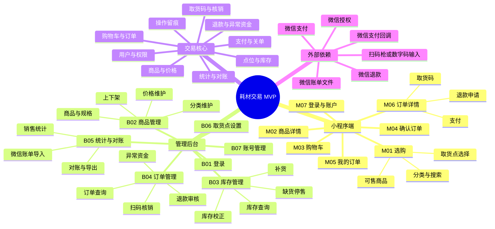
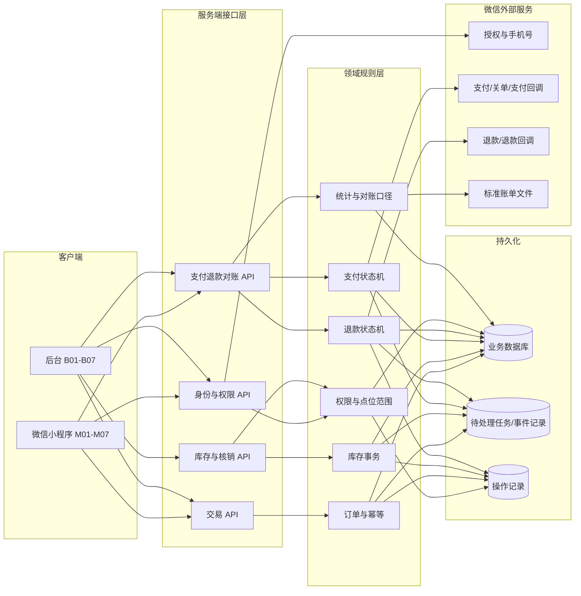
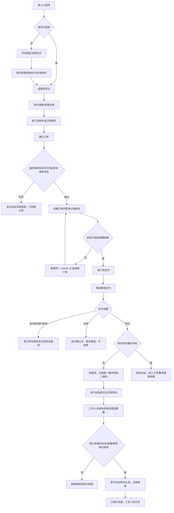
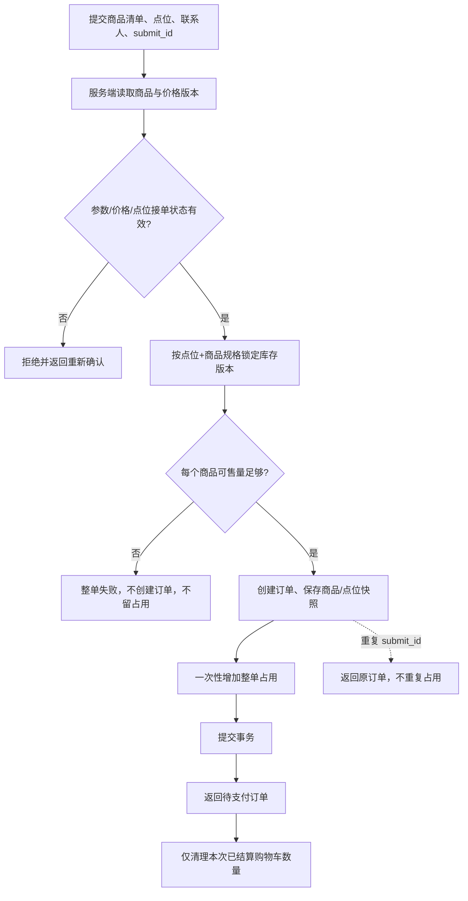
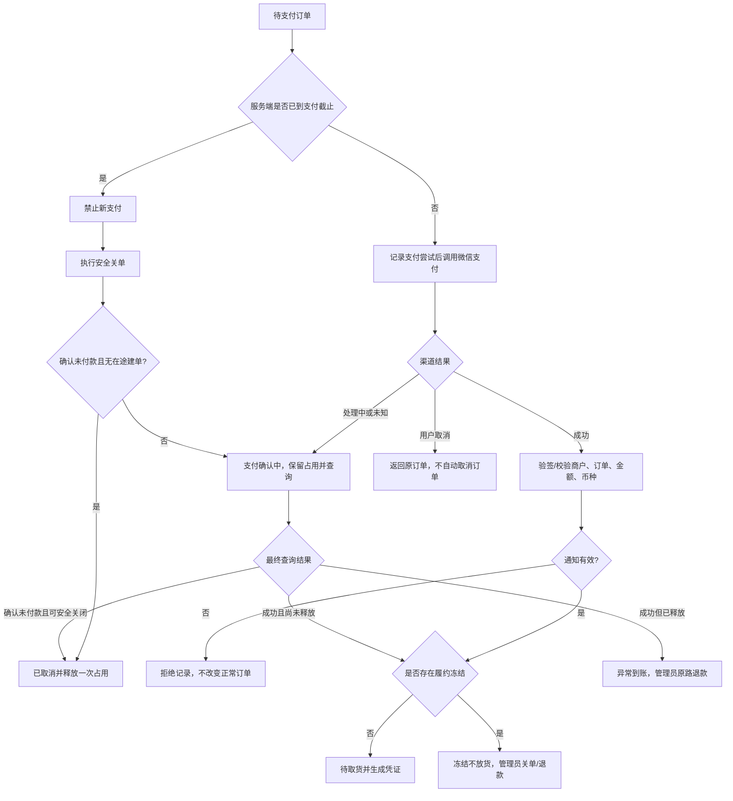
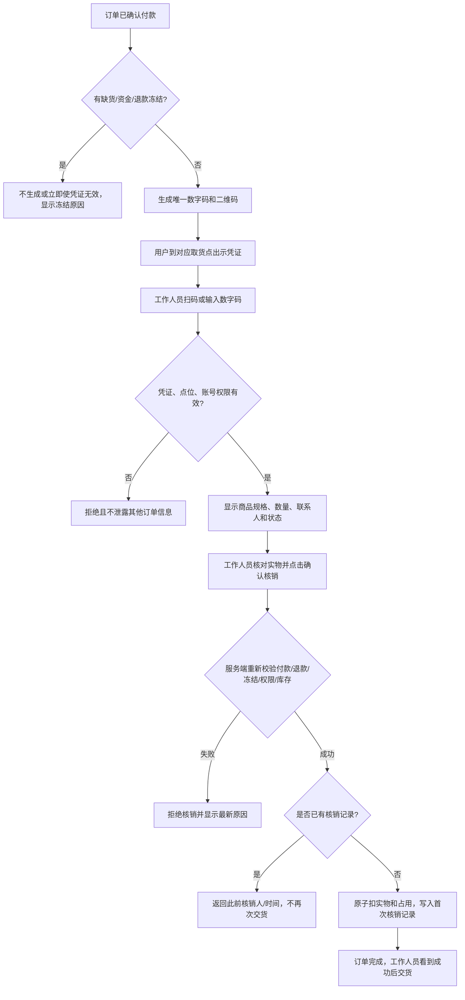
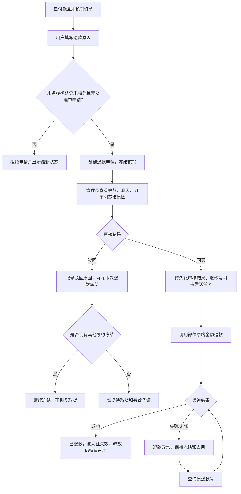
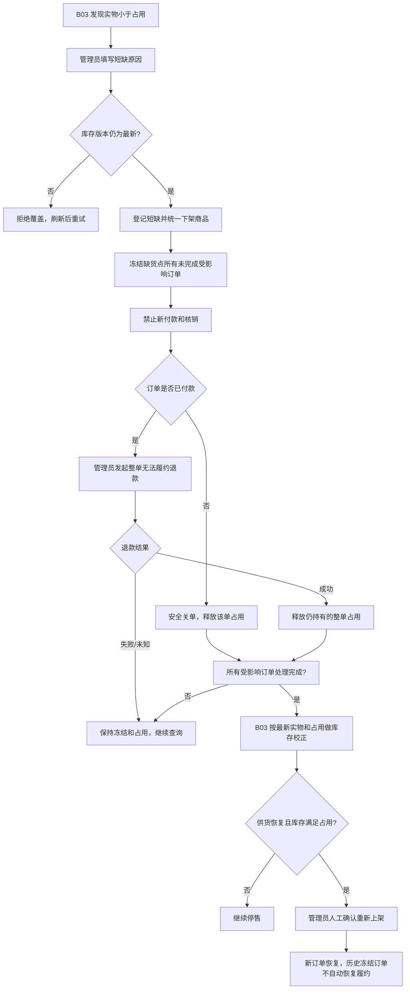
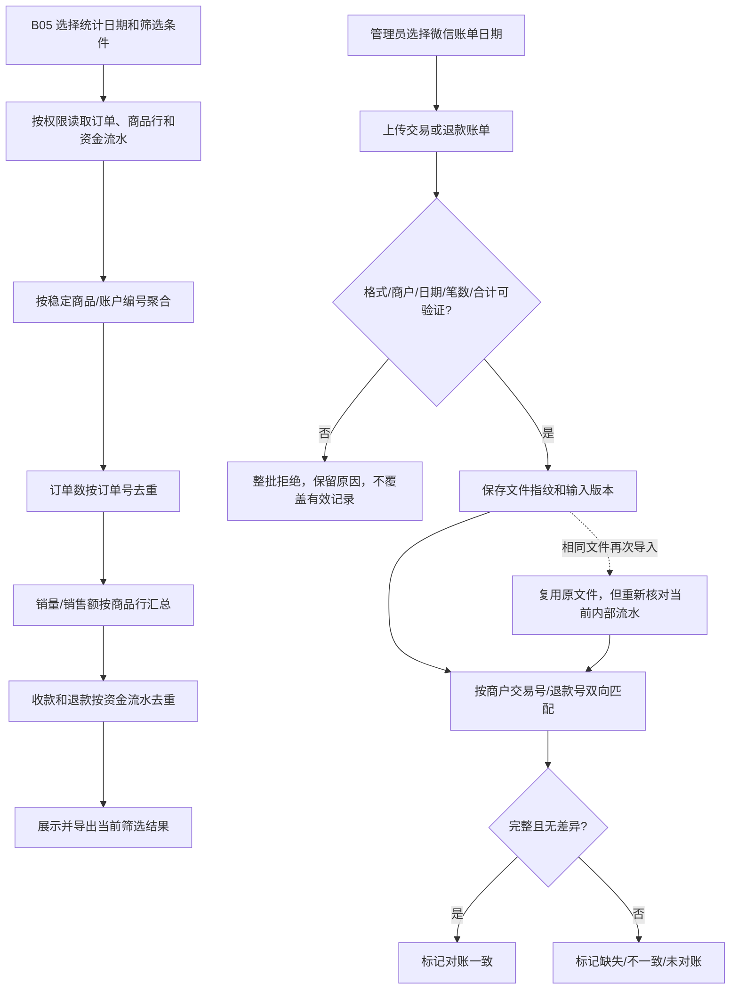
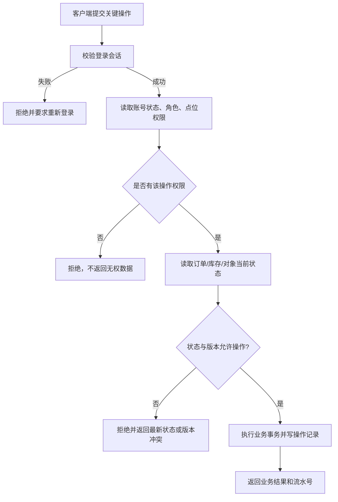

# 耗材交易系统｜最小 MVP 产品需求说明书（PRD）

版本：v1.1  
日期：2026-10-13  
状态：开发前评审稿（补充模块拆解与流程图），待产品确认后冻结  
配套文档：[最小 MVP 需求与原型执行方案 v1.3](./耗材交易系统_最小MVP需求与原型执行方案_v1.3.md)  
配套压测：[第二轮需求闭环压测记录 v1.3](./耗材交易系统_第二轮需求闭环压测记录_v1.3.md)

> **当前交付基线（2026-10-29）**：本目录当前交付的是 P0 精简版。P1 的取消与退款、核销记录与对账、退款审核、销售统计不进入当前验收；文中保留的 P1 章节仅作为后续扩展参考。当前界面与页面级 PRD 以运行原型右侧面板为准。P0 待支付订单不设置自动关单倒计时。

> 本 PRD 是开发实现依据。页面视觉、布局和交互顺序以确认后的原型为准；业务规则、状态、校验、权限和数据口径以本 PRD 为准。两者冲突时，先暂停实现并由产品确认，不允许开发自行放宽交易规则。

---

## 1. 文档目标

本系统面向单一运营方销售耗材，用户通过微信小程序选择取货点、下单、微信付款，到指定点自提；工作人员在管理后台核对订单并扫码核销。第一版必须形成完整闭环：

**登录 → 选点 → 浏览商品 → 下单占用库存 → 支付 → 生成取货凭证 → 现场核销 → 完成订单**

并覆盖异常闭环：

**未付款安全取消、支付结果未知、退款申请与审核、退款回调、缺货冻结、运营方无法履约退款、库存校正、基础统计与微信账单核对。**

本版本追求最小可用范围，页面少但状态不能省略。

## 2. 产品范围

### 2.1 本期包含

| 范围 | 本期要求 |
|---|---|
| 运营方式 | 单一运营方；不做多商户入驻、商户结算或分账 |
| 履约方式 | 仅到点自提；不做快递、配送、预约备货 |
| 取货点 | 多个取货点；库存按“取货点 × 商品规格”独立维护 |
| 交易 | 整单下单、整单支付、整单取货、整单退款 |
| 商品 | 单层分类；一条可售商品记录对应一个确定规格和单位 |
| 价格 | 各取货点统一售价；订单保存成交快照 |
| 账号 | 管理员、取货员两种固定后台账号类型 |
| 退款 | 已付款未核销可申请整单退款；管理员审核后微信原路退款 |
| 对账 | 手动导入微信标准账单并做基础核对；不做自动拉账 |
| 页面 | 小程序 7 个页面模板，后台 7 个页面模板 |
| 统计 | 按日期、品类、客户等维度查看销量和销售额，支持导出 |

### 2.2 明确不做

多商户、配送、赊账、部分取货、部分退款、优惠券、会员等级、发票、打印、供应商采购、采购入库、调拨、损耗单、库存预警、自动抓账、差异工单、财务审批体系、独立日志中心、客户管理模块、售后工单模块。

### 2.3 待确认后才能冻结的规则

以下内容已写入方案和本 PRD，但在产品确认前属于待确认项，开发不得擅自扩大：

1. P0 不设置待支付倒计时或自动关单，待支付订单保留。
2. 工作人员首次核销成功即完成订单，用户不做二次确认。
3. B03 增加管理员带原因的库存校正弹窗。
4. 发生短缺时统一下架商品、冻结缺货点受影响订单，并由管理员关单或整单退款。
5. 运营方无法履约时，管理员可主动发起整单原路退款。
6. 手工账单无法证明完整性时只显示“导入范围匹配／完整性待确认”。

## 3. 角色与权限

### 3.1 用户端角色

**微信用户**

- 可以浏览商品、选择取货点、管理当前点购物车、创建订单、发起支付、查看订单及取货码、申请退款。
- 只能查看本人订单和本人相关支付／退款信息。
- 未授权微信身份或手机号时可以浏览；提交订单前必须完成必要授权。
- 退款始终原路退回实际支付渠道，不因填写取货联系人而改变收款人。

### 3.2 后台角色

| 权限 | 管理员 | 取货员 |
|---|---:|---:|
| 登录、退出、本人改密 | ✓ | ✓ |
| 查看全部点位订单 | ✓ | 仅分配点位 |
| 修改商品、分类、价格、上下架 | ✓ | — |
| 查看库存、补货、库存校正 | ✓ | — |
| 管理取货点 | ✓ | — |
| 订单查询 | ✓ | 仅分配点位 |
| 扫码／输码核销 | ✓ | 仅分配点位 |
| 退款审核 | ✓ | — |
| 无法履约主动退款 | ✓ | — |
| 资金异常处理 | ✓ | — |
| 微信账单导入、对账、统计导出 | ✓ | — |
| 账号创建、停用、点位分配 | ✓ | — |

权限由服务端每次请求校验，隐藏按钮不能替代权限控制。账号停用、密码修改、点位权限移除后，已打开页面再次提交也必须重新校验。

系统始终至少保留一名启用管理员；不得通过并发操作将最后一名管理员停用或降级。取货员创建时必须至少分配一个有效取货点。

## 4. 核心业务对象

以下为开发最小数据模型。字段名称可按技术栈调整，但语义必须保留。

### 4.1 用户（User）

- `id`：系统稳定账户编号。
- `wechat_open_id/union_id`：微信身份标识，按主体能力选用，唯一。
- `mobile`：授权手机号，可变更但不作为历史身份主键。
- `display_name`：展示名称。
- `status`：正常／停用。
- `created_at`、`updated_at`。

### 4.2 取货点（PickupPoint）

- `id)、`name)、`address)、`business_hours)、`phone`。
- `accepting_orders`：是否接受新订单。
- `status`：启用／停用。
- 停用点位不物理删除；存在未结订单时不得修改订单实际领取地址。
- 暂停接单只阻止新订单，不影响既有订单继续支付和履约，除非订单被单独标记无法履约冻结。

### 4.3 商品与分类（Category、Product）

Product 必须包含：

- `id)：稳定商品规格编号。
- `category_id)、`name)、`specification)、`unit)、`image_url)。
- `price)：金额以分存储，正数，最多两位小数。
- `status)：上架／下架／停用。
- `version)：并发编辑版本。
- 调价、名称、图片编辑不能改写历史订单快照。
- 已有库存或交易的商品／规格不能改成另一种规格或单位；应停用旧记录后新建。

Category 为单层分类。存在商品关联时不允许直接物理删除，可停用。

### 4.4 库存（Inventory）

唯一键为 `pickup_point_id + product_id)。

- `physical_qty)：实物库存，非负整数。
- `reserved_qty)：订单占用，非负整数。
- `available_qty = physical_qty - reserved_qty)。
- `version)：库存并发版本。
- `updated_at)。

库存事件：

| 事件 | 实物 | 占用 | 说明 |
|---|---:|---:|---|
| 补货 | +q | 不变 | q 为正整数 |
| 创建订单 | 不变 | +q | 整单成功后一次性占用 |
| 支付成功 | 不变 | 不变 | 支付不重复占用 |
| 未付款安全关闭 | 不变 | -q | 只释放该订单仍持有的占用 |
| 核销成功 | -q | -q | 同一事务完成 |
| 退款成功 | 不变 | -q | 未出库，不增加实物 |
| 已释放订单异常到账退款 | 不变 | 不变 | 不得重复释放 |

任何库存事件与订单状态变更必须原子生效；重复请求只生效一次。

### 4.5 订单（Order、OrderItem）

Order 至少包含：

- `id)、`order_no)、`user_id)、`pickup_point_id)。
- `status)：见第 6 节主状态。
- `payment_status)、`refund_status)、`pickup_status)。
- `freeze_reasons)：退款冻结、缺货冻结、资金异常冻结等，可并存。
- `total_amount)、`paid_amount)、`refunded_amount)，均按分。
- `contact_name)、`contact_phone)、`remark)。
- `created_at)、`payment_deadline_at)、`paid_at)、`picked_up_at)、`canceled_at)。
- `submit_id)：客户端提交幂等标识，按用户唯一约束。
- 取货点名称、地址、电话及商品名称、规格、单位、单价必须保存成交快照。

OrderItem 至少包含商品稳定编号、商品快照、单价、数量、行金额。订单总金额由服务端重新计算，不能信任客户端传入。

### 4.6 支付尝试（PaymentAttempt）

- 商户订单号、支付尝试号、渠道支付单号。
- 应付金额、币种、商户／小程序归属。
- 状态：未创建、创建中、支付中、成功、关闭中、已关闭、未知、异常到账。
- 首次请求前持久化记录；同一支付尝试重试必须复用稳定标识。
- 建单结果未知时不得因“查无此单”直接释放库存。

### 4.7 退款申请与退款尝试（RefundRequest、RefundAttempt）

RefundRequest：

- 申请号、订单号、申请人／处理人、原因、申请类型（用户申请／无法履约／异常到账）。
- 状态：审核中、已驳回、退款中、退款成功、退款失败／未知。
- 审核结果、审核原因、审核时间。

RefundAttempt：

- 商户退款号、原支付单号、退款金额、币种、渠道状态、重试次数。
- 同一有效退款请求重试复用同一商户退款号。
- 渠道确认全额退款成功后才能释放占用。

### 4.8 核销记录（PickupVerification）

- 核销记录号、订单号、取货点、核销人、核销时间。
- 结果：首次核销成功／此前已核销／拒绝及原因。
- 首次成功只允许一条；重复扫码返回原结果，不能再次交货或扣库存。

### 4.9 对账导入（ReconciliationImport）

- 文件指纹、文件类型、商户号、账单日期、导入人、导入时间、输入版本。
- 范围状态：完整／部分／待确认。
- 对账结果：一致／缺失／不一致／未对账。
- 相同文件可复用原始文件，但内部流水变化后必须重新核对，不能直接沿用旧结论。

## 5. 全局业务规则

### 5.1 购物车与点位

1. 购物车只属于当前取货点；购物车不占库存。
2. 切换点位时购物车非空，必须明确确认清空；取消则保持原点和购物车。
3. 订单只能属于一个点位，下单后不可直接改点。
4. “立即购买”独立结算，不清空原购物车。
5. 订单创建成功后只清理本次已结算的购物车数量；未勾选商品保留。
6. 登录切换时清理原账户的订单、手机号、取货码和待提交结果；购物车不转移。

### 5.2 商品与价格

1. 商品列表只展示已上架且当前点可售库存大于 0 的商品。
2. 商品详情、购物车、确认订单均显示当前点、规格、单位、单价和可售量。
3. 提交时重新校验商品状态、点位接单状态、库存、价格版本。
4. 任一商品不足时整单失败，不创建部分订单，不残留部分占用。
5. 价格、商品上下架、暂停接单与创建订单并发时，使用一致配置版本：要么按已确认快照成功，要么整单失败并要求重新确认。
6. 后端不信任客户端金额、单价、用户编号、点位归属或库存数量。

### 5.3 订单与幂等

1. 同一 `submit_id` 在相同用户、点位、商品数量和价格版本下重试，返回原订单。
2. 同一 `submit_id` 携带不同参数必须拒绝，提示查看原结果。
3. 超时、丢响应、重复点击不能生成重复订单或重复占用。
4. 用户明确再次购买时使用新的提交标识，创建新交易。
5. 创建订单时服务端记录订单创建时间；支付期限从该时间起算，客户端倒计时仅用于展示。

### 5.4 支付与取消

1. 只有服务端确认渠道真实支付成功，订单才可进入待取货或冻结处置。
2. 支付成功且无其他履约冻结：订单转待取货，生成唯一数字码和二维码。
3. 支付成功但有缺货、资金异常等冻结：保持冻结并进入关单／退款处理，不放货。
4. 支付取消不等于订单取消；期限内可从原订单继续支付。
5. 未付款订单取消或超时，必须先确认未付款且支付入口已安全关闭，并排除在途建单，才可释放占用。
6. 关单处理中禁止新发起支付，但仍接收已发起支付的真实结果。
7. 支付结果未知时先查询，不放货、不重复建单、不立即释放库存。
8. 本地已释放库存后确认到账，标记异常到账，由管理员全额原路退款；不恢复取货资格。
9. 无效来源、错商户、错订单、错金额或错币种通知只拒绝并记录，不冻结正常订单。
10. 可信渠道确认的真实异常收款才可冻结相应未核销订单。

### 5.5 取货与核销

1. 核销前检查订单已付款、未核销、无退款／缺货／资金异常冻结、点位匹配、账号有权限。
2. 扫码或输码只查询，不自动核销；工作人员必须核对商品规格和数量后点击确认。
3. 核销确认时重新读取最新订单、库存和权限状态。
4. 核销成功同时扣实物和占用，记录人、时间、点位。
5. 首次核销成功后才能交货；响应丢失必须先查询结果。
6. 重复核销只返回此前结果，不再次扣库存或引导重复交货。
7. 无法整单交付时不得部分交货后核销；转人工协调或整单退款。
8. 普通下架、暂停接单不冻结既有订单；实际短缺必须使用单独的无法履约冻结。

### 5.6 退款

1. 已付款且未核销的订单可申请整单退款；已完成订单不开放普通退款。
2. 退款申请受理即冻结核销，不提供撤回申请。
3. 审核驳回必须填写原因，只解除本次退款冻结；仍有其他冻结时不恢复取货。
4. 审核同意先持久化审核结果、冻结状态、退款号和待发送请求，再调用渠道。
5. 退款成功以渠道确认足额原路退款为准，之后标记已退款并释放该订单仍持有的占用。
6. 退款失败或结果未知继续保持核销冻结和占用；管理员查询原请求后处理。
7. 同一有效退款请求重试使用同一商户退款号；未确认旧请求失败／关闭前不得并行新建。
8. 用户退款申请、管理员无法履约退款、核销确认以服务端成功顺序互斥。
9. 真实部分退款或金额异常只记录资金异常，不假装整单退款成功，不提供普通部分退款。

### 5.7 缺货与库存校正

1. 发现实物小于占用时，管理员登记原因并将商品下架；本期统一下架会影响所有点。
2. 缺货点包含该商品的未完成订单标记“无法履约冻结”，禁止新付款和核销。
3. 未付款订单按安全关单关闭；已付款订单由管理员发起整单原路退款。
4. 已在途付款之后成功，仍保持无法履约冻结并转退款，不自动放货。
5. 多商品订单任一项短缺也整单处理，不部分交付。
6. 短缺登记与下单、付款、核销并发时由服务端同一库存／订单事务裁决，不漏标受影响订单；已先成功核销的不回退。
7. 库存校正只调整实物数量，不能手工改写占用；校正后实物不得小于占用。
8. 校正提交校验最新库存版本；版本冲突拒绝覆盖并要求按最新值重试。
9. 退款释放不自动恢复可售；校正完成且供货恢复后才允许重新上架。
10. 退款驳回、补码、普通重新上架不能解除已有无法履约冻结。

### 5.8 账号与数据安全

1. 每个后台请求重新校验账号状态和点位权限。
2. 账号切换后清理前一账号私有数据，返回业务页面前重新拉取数据。
3. 手机号默认脱敏；只有履约必要且有权限的后台人员可查看。
4. 后台密码不得明文展示或记录。
5. 关键操作记录操作人、时间、前后值／原因：调价、上下架、补货、校正、核销、退款审核、退款结果、账号变更、点位变更。

## 6. 状态模型

开发应采用“订单主状态 + 支付状态 + 退款状态 + 取货状态 + 冻结原因”组合，不能只用一个字符串覆盖所有情况。

### 6.1 订单主状态

| 状态 | 含义 | 可执行主操作 |
|---|---|---|
| 待支付 | 订单已创建，尚未确认支付 | 去支付、取消 |
| 支付确认中 | 已有支付尝试，结果未知 | 查询结果、等待处理 |
| 关单处理中 | 正在确认支付单关闭 | 等待后台处理，不得新支付 |
| 待取货 | 已确认付款且无履约冻结 | 查看取货码、申请退款 |
| 退款审核中 | 退款申请已受理 | 等待审核，不可核销 |
| 退款中 | 已同意并等待渠道结果 | 查看进度，不可核销 |
| 退款异常 | 渠道失败或结果未知 | 管理员查询／重试 |
| 已退款 | 全额退款成功 | 查看退款结果，不可核销 |
| 已完成 | 首次核销成功 | 查看完成信息 |
| 已取消 | 确认未付款并安全关闭 | 查看取消原因 |

### 6.2 正交状态

**支付状态**：未发起、已建单、支付中、成功、关闭中、已关闭、未知、异常到账。  
**退款状态**：无、审核中、已驳回、退款中、成功、失败／未知。  
**取货状态**：未出码、出码中、有效、已核销、已失效。  
**冻结原因**：退款冻结、缺货冻结、资金异常冻结，可同时存在。

关键转换：

| 当前组合 | 触发 | 结果 |
|---|---|---|
| 待支付／关单处理中 + 渠道确认付款成功 | 无其他冻结 | 待取货 + 生成凭证 |
| 待支付／关单处理中 + 渠道确认付款成功 | 存在任一履约冻结 | 保持冻结并进入关单／退款处理 |
| 待支付 + 确认未付款且安全关闭 | 释放该单占用 | 已取消 |
| 待取货 + 用户受理退款 | 冻结核销 | 退款审核中 |
| 退款审核中 + 驳回 | 解除本次退款冻结 | 无其他冻结才恢复待取货 |
| 退款审核中 + 同意 | 持久化退款任务 | 退款中 |
| 退款中／退款异常 + 渠道全额成功 | 释放仍持有占用 | 已退款 |
| 任意已取消订单 + 真实异常到账 | 资金异常独立处理 | 不恢复履约、不重复释放 |
| 已完成／已退款 + 重复请求 | 幂等返回原结果 | 不回退状态 |

## 7. 小程序页面需求

页面编号与原型一致。每页必须实现加载中、空数据、失败、提交中、成功和不可操作状态。

### M01 选购

**目标**：按当前取货点浏览可购买商品。

- 顶部显示当前取货点；点击打开点位选择弹层。
- 点位弹层显示名称、地址、营业时间、接单状态。
- 支持单层分类和名称关键词搜索。
- 商品卡显示图片、名称、规格、单位、价格、可售数量。
- 列表只展示已上架且当前点可售量大于 0 的商品；购物车或订单详情中的商品后来下架／售罄时保留条目并显示失效原因，不允许继续结算。
- 切点且购物车非空时必须二次确认清空；取消切点不改变现有数据。
- 点位暂停接单时禁止新订单并给出原因，已有订单仍可查看。

### M02 商品详情

- 显示商品图片、名称、规格、单位、当前点售价、可售量。
- 数量只能是正整数，不能超过当前可售量。
- 支持“加入购物车”和“立即购买”。
- 加入购物车不占库存；服务端或回到结算页时重新校验可售量。
- 商品下架、点位暂停或价格变化时，提交前阻断并提示重新确认。

### M03 购物车

- 只显示当前点商品；展示勾选、数量、单价、行金额和合计。
- 支持增减数量、删除、全选／取消全选。
- 售罄、下架、点位停止接单或价格版本变化时标记失效，不允许直接结算。
- 结算只提交勾选项；未勾选项保留。
- 切点清空后购物车为空，不跨点合并。

### M04 确认订单

- 展示商品快照、数量、单价、行金额、总金额、取货点、联系人、联系电话和备注。
- 联系人和电话为必填；联系人为空提示“请填写联系人”，电话为空提示“请填写联系电话”，手机号格式错误提示“请输入有效的 11 位手机号码”；取货点来自已配置点位，不允许自由输入。
- 错误提示显示在对应输入框下方，并聚焦第一个错误字段；备注最多 200 字。
- 金额由服务端重算；前端展示金额仅供确认。
- 提交按钮有提交中状态，禁止重复点击。
- 提交失败必须说明库存不足、价格变化、点位暂停、商品下架或参数错误等原因。
- 成功后跳转 M06 订单详情；按 `submit_id` 可恢复原订单。

### M05 我的订单

- 状态筛选：全部、待支付、待取货、已完成、已取消、退款。
- 列表显示订单号、创建时间、取货点、商品摘要、金额、当前状态、可执行主操作。
- 支付确认中、退款审核中、退款中、退款异常、已退款等在订单卡和详情中显示标签。
- 订单列表查询只返回当前用户订单；刷新不改变状态。
- 点击订单进入 M06。

### M06 订单详情

- 展示订单号、商品明细、成交快照、取货点、联系人、支付状态、退款状态、取货状态和操作记录。
- 待支付：显示去支付；P0 不设置支付倒计时或自动关单。
- 待取货：显示有效数字码和二维码、取货点提示、申请退款。
- 出码失败：显示已付款、取货码生成中；若有冻结则显示冻结原因，不能暗示可取。已付款未核销即使尚未出码，也允许发起整单退款。
- 退款审核中／退款中／退款异常：显示进度，隐藏或使取货码无效。
- 已退款／已完成／已取消：显示结果及时间，不显示不适用按钮。
- 退款申请弹层要求填写原因；提交成功后不可撤回。
- 所有动作提交前读取最新状态，冲突时显示最新结果。

### M07 账号与登录

- 微信授权登录、手机号授权绑定、拒绝授权和重试。
- 展示当前账户基本信息和隐私／协议入口。
- 首次授权失败可返回浏览，不阻断浏览。
- 账户切换后清理原账户私有数据并重新拉取。
- 不提供短信登录、账户合并或手机号替代微信身份。

## 8. 管理后台页面需求

### B01 登录

- 账号、密码输入；显示必填、错误、账号停用、密码过期／首次登录等状态。
- 登录成功后按角色进入可访问页面。
- 登录失效、退出或切换账号时清理旧页面私有数据。
- 不提供后台自助注册；初始管理员由部署初始化。

### B02 商品管理

- 商品列表支持名称、分类、状态筛选。
- 新增／编辑字段：名称、规格、单位、分类、图片、售价、上下架状态。
- 商品一条记录对应一个规格，不做多属性组合器。
- 价格变更记录操作人、时间、旧值、新值；不能修改历史订单快照。
- 有库存或交易的商品不能物理删除或改变规格语义，只能停用并新建。
- 分类有关联商品时不能物理删除。
- 图片限制 JPEG／PNG、单张不超过 5 MB；正式开发校验真实文件类型。

### B03 库存管理

- 按点位、商品、分类、库存状态查询实物、占用、可售。
- 支持补货：数量为正整数，填写备注可选，保存点位、商品、数量、操作人、时间。
- 支持库存校正：仅管理员；校正后实物为非负整数且不小于占用；原因必填；提交做版本校验。
- 当实物小于占用时，禁止直接校正，显示“登记短缺并停售”确认。
- 登记短缺后统一下架、冻结缺货点受影响订单，B04 处理关单／退款。
- 显示库存明细抽屉；不建设独立库存流水页面。
- 重复提交和版本冲突必须有明确结果。

### B04 订单管理

- 标签至少包含订单、待退款审核、核销记录。
- 订单筛选：订单号、用户、取货点、支付状态、履约状态、退款状态、冻结原因、时间。
- 订单详情展示商品快照、客户信息、支付尝试、退款申请／尝试、核销记录、操作时间线。
- 扫码／输码只查询；必须显示点位、商品和数量，工作人员确认后才核销。
- 核销成功同时扣实物和占用；重复扫码显示此前核销人和时间。
- 退款审核：同意、驳回；驳回原因必填；同意需二次确认并展示全额金额。
- 管理员可对已付款未核销订单发起“无法履约整单退款”，原因必填。
- 渠道结果未知时提供查询／重试，不允许并行创建第二笔退款。
- 取货员隐藏退款审核、金额、库存、财务和全量订单操作；接口也必须拒绝越权请求。

### B05 统计与对账

分为“销售统计”和“微信对账”两个标签。

**销售统计**

- 时间范围：起始日 00:00（含）至结束日次日 00:00（不含）。
- 支持按品类、商品规格、客户、取货点查看销量和销售额。
- 多商品订单按行汇总；订单数按订单号去重；收款／退款按资金流水去重。
- 收款按渠道实际成功时间，退款按渠道实际成功时间作为独立负向事件。
- 导出当前筛选和权限范围，标注生成时间和统计口径。

**微信对账**

- 管理员选择账单日期并导入交易账单或退款账单。
- 校验文件类型、商户、日期、笔数、合计、重复记录和可解析性。
- 部分解析、类型不匹配或完整性不明时不得标记一致。
- 结果显示一致、缺失、不一致、未对账、导入范围匹配／完整性待确认。
- 相同文件重复导入可复用原文件；内部流水变化后必须重新核对。
- 不依赖手机号或取货码匹配，使用商户交易号／退款号。
- 不做自动抓账、差异工单或财务审批。

### B06 取货点设置

- 字段：名称、地址、营业时间、联系电话、接单状态、启停状态。
- 新增／编辑需校验必填和长度。
- 暂停接单只阻止新订单，不取消既有订单。
- 存在未结订单时不得修改实际领取地址；点位仅停用不删除。
- 影响范围和保存结果明确提示。

### B07 账号管理

- 管理员查看、创建、编辑、停用账号。
- 固定角色：管理员、取货员；取货员必须分配至少一个点位。
- 支持初始密码、重置密码、本人改密；密码不得明文回显。
- 停用、角色变化、点位权限变化记录操作人和时间。
- 最后一名启用管理员不可停用或降级，并处理并发冲突。
- 取货员从顶部本人账户菜单进入本人改密，不因改密开放账号管理权限。

## 9. 服务端接口与一致性要求

接口命名由开发确定，但必须满足以下逻辑契约。

### 9.1 通用要求

- 所有写操作返回业务结果、业务状态、可展示提示和可追踪流水号。
- 关键写操作携带幂等键：创建订单、取消／关单、核销、退款申请、退款审核、补货、库存校正、账单导入。
- 服务端校验登录身份、角色、点位权限、状态、版本和金额。
- 失败不得只返回 HTTP 成功但业务无结果；客户端可据业务流水号查询最终状态。
- 所有时间在服务端保存并统一使用中国标准时间展示；渠道时间另存实际发生时间。

### 9.2 最小逻辑服务

1. 用户授权与账户查询。
2. 点位列表、点位状态查询。
3. 商品、分类、当前点可售库存查询。
4. 购物车读写。
5. 订单创建、订单详情、订单列表。
6. 支付单创建、支付结果查询、支付回调接收、关单。
7. 取货码查询、核销预览、核销确认。
8. 退款申请、审核、退款结果查询、退款回调接收。
9. 库存查询、补货、校正、短缺登记。
10. 账号、点位和商品管理。
11. 统计查询、账单导入、对账结果查询和导出。

### 9.3 支付与退款回调

- 回调先验签，再校验商户／小程序归属、订单号、金额、币种和状态。
- 回调重复到达必须幂等；无效通知只记录拒绝原因。
- 支付和退款回调均绑定具体尝试号，不允许用订单号模糊覆盖另一笔尝试。
- 渠道成功而本地响应丢失时，以主动查询补齐本地状态。
- 回调处理必须与库存和订单状态的原子规则一致，不能先放货后补记录。

### 9.4 并发与恢复

必须覆盖：

- 最后一件库存的并发下单；
- 退款审核与核销并发；
- 缺货登记与下单／支付／核销并发；
- 关单与支付建单并发；
- 重复回调、重复点击、网络重试；
- 服务重启后待发送退款和未知支付结果恢复；
- 库存补货／校正与核销并发；
- 最后一名管理员停用并发。

服务恢复后应从持久记录继续推进，不依赖用户重新打开页面。

## 10. 错误与提示要求

提示必须说明当前状态和下一步动作，不能只显示“操作失败”。

| 场景 | 用户／工作人员应看到 |
|---|---|
| 库存不足 | “商品库存不足，请调整数量”并标明受影响商品 |
| 价格变化 | “商品价格已变化，请重新确认订单” |
| 点位暂停接单 | “当前取货点暂不接受新订单” |
| 支付结果未知 | “支付结果确认中，请稍后查询，不要重复支付” |
| 订单已安全取消 | “订单已取消，占用已释放” |
| 已付款但冻结 | “已付款，当前暂无法取货：{冻结原因}，请等待处理” |
| 取货码生成中 | “已付款，取货码生成中，请勿重复支付” |
| 重复核销 | “该订单已于{时间}由{人员}核销，请勿重复交付” |
| 跨点核销 | “该订单不属于当前取货点” |
| 退款审核中 | “退款申请已提交，等待审核，暂不可取货” |
| 退款被驳回 | 展示驳回原因；仅无其他冻结时提供再次申请／取货 |
| 退款结果未知 | “退款结果确认中，暂不可取货” |
| 权限失效 | “账号权限已变化，请刷新或重新登录” |
| 版本冲突 | “数据已被其他操作更新，请刷新后重试” |
| 对账不完整 | “已导入范围匹配，账单完整性待确认” |

错误提示不得泄露其他用户订单存在性、手机号或取货码。

## 11. 原型与 PRD 验收标准

原型确认后，开发实现至少按 A01–A10 验收：

| 编号 | 验收目标 |
|---|---|
| A01 | 授权失败可重试；切点不静默丢购物车；商品和库存属于当前点 |
| A02 | 正常购买、支付、出码、核销、完成和库存变化正确 |
| A03 | 库存不足、调价、下架有明确阻断；不超卖、不残留部分占用；订单保留快照 |
| A04 | 未建支付单可安全取消；在途建单先查明；支付未知可恢复；晚到账不放货 |
| A05 | 重复核销、无效码、跨点码和并发核销均正确拦截 |
| A06 | 退款申请、驳回、同意、失败、无法履约退款状态完整；驳回不解除其他冻结 |
| A07 | 退款与核销只允许一方成功；重复回调不重复扣减或释放 |
| A08 | 补货、校正、短缺冻结、账号改密、点位权限和最后管理员约束有效 |
| A09 | 统计和对账时间、单位、订单去重、资金发生日口径正确，可追溯导出 |
| A10 | 各页面有加载、空数据、失败、提交中、成功和关键错误状态，移动端／桌面端无关键遮挡 |

### 11.1 开发自测必测用例

- 两人同时购买最后 1 件：仅一个订单占用成功。
- 同一 `submit_id` 重试：只返回同一订单。
- 支付回调与关单同时到达：不出现既释放又放货。
- 支付结果未知：不重复付款、不立即释放。
- 重复支付回调、退款回调：不重复记账。
- 同时核销同一码：仅首次成功。
- 退款与核销并发：仅一方成功。
- 渠道退款成功但本地超时：查询同一退款号补齐。
- 缺货登记与下单／核销并发：新受影响订单被冻结，已完成订单不回退。
- 退款驳回仍有缺货冻结：不得恢复取货。
- 库存校正版本冲突：拒绝过期覆盖。
- 取货员跨点核销、审核退款、查看非授权订单：全部拒绝。
- 最后一名管理员并发停用：至少一名管理员保留。
- 相同账单重复导入且内部流水改变：重新核对，不沿用旧结论。
- 多商品订单统计：订单金额不重复累计。

## 12. 非功能要求

### 12.1 一致性

库存占用、释放、核销、退款成功和订单状态变更必须具备事务一致性或等价补偿机制；禁止出现订单已完成但库存未扣、订单已取消但占用未释放、退款成功但占用重复释放。

### 12.2 安全

支付／退款回调验签；服务端重新计价；敏感字段脱敏；后台按角色和点位鉴权；取货码不可预测并限制尝试频率；所有关键操作留痕。

### 12.3 可恢复性

支付、退款和库存关键操作必须持久化；服务重启可恢复待处理任务；未知结果必须提供查询路径；不得把用户刷新作为唯一补偿触发条件。

### 12.4 可用性

移动端适配常用微信小程序尺寸，后台适配桌面浏览器。所有关键动作有提交中、成功、失败和重复提交反馈；网络中断恢复后可查询最终状态。

### 12.5 数据与隐私

只采集完成履约需要的用户资料；手机号默认脱敏；订单和统计按稳定账户编号关联；导出受角色权限限制；原型使用虚构数据，不使用真实用户信息。

## 13. 开发交付边界

### 13.1 开发前必须冻结

- 本 PRD 版本和确认点。
- 页面原型及页面状态。
- 商品、点位、账号、订单、支付、退款和库存字段。
- 微信支付／退款主体、商户号、回调地址、退款期限和账单格式。
- 取货码长度、有效期和扫码设备方案。
- 失败重试、任务恢复和库存事务实现方式。

### 13.2 开发阶段必须提供

- 数据库迁移和初始化数据脚本。
- 接口文档及错误码。
- 支付／退款沙箱或模拟渠道。
- 并发、重复回调、服务重启和权限测试记录。
- 管理员与取货员测试账号。
- A01–A10 验收结果和未通过项清单。

### 13.3 不能用原型替代的验证

原型只能验证页面结构、状态表达和模拟操作。真实微信支付、真实退款、回调验签、并发锁、服务崩溃恢复、扫码设备、现场备货与交付必须在开发测试和现场验收阶段单独验证。

## 14. 需求追踪

本 PRD 覆盖原功能清单全部 22 项：

1. 微信授权登录：M07。
2. 品类浏览：M01。
3. 商品详情：M02。
4. 搜索筛选：M01。
5. 下单：M02–M04。
6. 金额确认：M04。
7. 在线支付：M06。
8. 取货码生成：M06。
9. 我的订单：M05–M06。
10. 出示取货码：M06、B04。
11. 确认取货：B04 核销，M06 显示完成。
12. 取消退款：M06。
13. 账号管理：B01、B07。
14. 品类维护：B02。
15. 价格维护：B02。
16. 库存补货：B03。
17. 库存查询：B03。
18. 订单管理：B04。
19. 扫码核销：B04。
20. 核销记录与对账：B04、B05。
21. 退款审核：B04。
22. 销售统计：B05。

**PRD 冻结原则：**未确认的待确认项不作为已批准范围；开发发现页面、接口和本 PRD存在冲突时，必须回到产品确认，不得以“先做出来”为理由改变库存、支付、退款或权限规则。

## 15. 模块思维导图与系统拆解

本节用于开发任务拆分。页面是交互载体，模块是业务边界；同一页面可以调用多个模块，但库存、支付、退款和权限不得在页面层自行实现。

### 15.1 产品模块思维导图

### 15.2 模块职责、页面、服务和数据映射

| 模块 | 页面入口 | 逻辑服务 | 核心数据 | 开发边界 |
|---|---|---|---|---|
| 身份与权限 | M07、B01、B07 | 授权、登录、鉴权、改密、账号状态 | User、后台账号、角色、点位权限 | 服务端每次请求校验，页面隐藏不等于授权 |
| 点位 | M01、M04、B06 | 点位查询、接单状态、点位配置 | PickupPoint、点位快照 | 一个订单只能归属一个点位 |
| 商品目录 | M01、M02、B02 | 分类、商品、规格、价格、上下架 | Category、Product、价格版本 | 有交易的规格只能停用，不能改语义 |
| 购物车 | M02、M03、M04 | 当前账户当前点购物车 | Cart、CartItem | 不占库存，切点需确认清空 |
| 订单 | M04、M05、M06、B04 | 创建、查询、取消、状态推进 | Order、OrderItem | 服务端计价、整单原子占用、提交幂等 |
| 支付 | M06、B04 | 建单、支付查询、关单、支付回调 | PaymentAttempt | 真实支付成功前不放货 |
| 库存 | M01、M02、B03、B04 | 可售查询、占用、释放、核销扣减、补货、校正 | Inventory、库存事件 | 实物、占用、可售不可混用 |
| 取货核销 | M06、B04 | 凭证生成、扫码查询、核销确认 | PickupCredential、PickupVerification | 查询和确认分离，首次成功才交货 |
| 退款 | M06、B04 | 申请、审核、渠道退款、结果查询、回调 | RefundRequest、RefundAttempt | 全额原路退款，结果未知不释放占用 |
| 缺货处置 | B03、B04、M06 | 登记短缺、停售、冻结订单、关单／退款 | ShortageRecord、Order.freeze_reasons | 不新增售后模块，不部分交付 |
| 统计对账 | B05 | 统计聚合、账单导入、差异核对、导出 | StatisticsView、ReconciliationImport | 订单数、行金额、资金流水分别去重 |
| 操作留痕 | 各后台详情 | 关键动作记录 | AuditRecord | 不建设独立日志页面，嵌入相关详情 |

### 15.3 系统分层与依赖方向

依赖规则：客户端只能调用接口；接口负责鉴权和参数校验；领域服务负责状态和事务；外部渠道结果必须持久化后再驱动业务状态；页面不得直接修改库存、支付或退款状态。

## 16. 全链路流程图

### 16.1 用户正常购买总流程

### 16.2 下单与库存占用流程

### 16.3 支付、关单与回调流程

支付回调与关单并发时，最终状态必须由服务端持久状态和渠道查询结果裁决；不能依据前端支付窗口结果直接放货。

### 16.4 取货码与核销流程

### 16.5 用户退款与管理员审核流程

管理员发起无法履约退款时，从“已付款未核销”节点直接进入 L；已有待审核申请复用原申请，已有进行中渠道退款只查询和恢复，不能并行新退款。

### 16.6 缺货登记与处置流程

短缺登记与下单、付款、核销并发时，以服务端库存／订单事务顺序裁决；已先成功核销的订单不回退，刚创建的受影响订单不得漏标。

### 16.7 统计与微信对账流程

### 16.8 权限与越权拦截流程

## 17. 开发任务拆解与依赖顺序

### 17.1 建议迭代顺序

| 阶段 | 开发内容 | 完成出口 | 前置依赖 |
|---|---|---|---|
| P0 | 数据模型、账号、点位、商品、分类、库存基础表 | 可初始化两个测试点位和五类商品 | 产品冻结字段 |
| P1 | M01–M04、购物车、订单创建、整单库存占用 | 可完成未支付订单创建与安全取消 | P0 |
| P2 | 支付尝试、查询、关单、模拟支付回调、M05–M06 | 可完成支付成功、未知、取消、晚到账演练 | P1、支付测试配置 |
| P3 | 取货码、B04 查询、扫码／输码、首次核销与重复核销 | 可完成一单自提闭环 | P2、扫码输入方案 |
| P4 | 用户退款、B04 审核、退款查询／回调、异常资金 | 可完成退款成功、驳回、失败／未知 | P2、退款测试配置 |
| P5 | B03 补货、校正、缺货冻结与无法履约退款 | 可演练缺货整单处置 | P3、P4；待确认项冻结后实施 |
| P6 | B02、B06、B07 完整管理能力 | 可维护商品、点位、账号和权限 | P0 |
| P7 | B05 统计、账单导入、对账、导出 | 可验证统计和账单口径 | P2、P4 |
| P8 | 并发、恢复、安全、设备和验收 | A01–A10 全部有证据 | P1–P7 |

### 17.2 每个功能交付的最小证据

开发提交每个模块时，至少提供：接口说明、状态转换说明、权限矩阵、成功／失败／重复请求测试、数据库变更、页面状态截图或录屏、未完成边界。涉及支付、退款、库存和核销时，必须补充并发或服务中断测试记录。

## 18. PRD 与原型的对应规则

| 情况 | 处理方式 |
|---|---|
| 原型有页面状态，PRD 有业务规则 | 按 PRD 实现状态和权限，按原型实现展示与交互 |
| 原型缺少 PRD 要求的异常状态 | 补原型状态，不删除 PRD 规则 |
| 原型按钮与 PRD 允许条件不一致 | 以 PRD 条件为准，调整按钮显隐和提交校验 |
| PRD 与原型都没有定义的边界 | 暂停实现，记录产品问题，不自行添加业务规则 |
| 待确认项尚未确认 | 不进入正式开发范围，可使用模拟占位但不能接入真实交易 |

原型制作阶段应至少展示本节 16.1–16.8 所覆盖的主要节点和异常分支；页面数量仍保持小程序 7 页、后台 7 页，不因补充流程图新增业务模块。

## 19. 原型工作台与页面图示索引

可运行原型目录：[耗材交易系统原型](./耗材交易系统原型/)。启动方式、页面导航和演示流程见目录内 README。

原型采用三种可切换工作区：

1. **小程序原型**：左侧固定 390 × 844 微信小程序手机窗口，包含状态栏、返回、页面标题、右上角关闭与更多、小程序底部 TabBar；右侧固定显示当前页面的 PRD 需求契约。
2. **管理后台**：桌面侧栏、指标卡、筛选、表格、详情和操作弹层，使用与小程序同一份本地演示领域数据。
3. **PRD 文档**：独立阅读完整 PRD，并提供模块思维导图、系统分层图、购买／支付／核销／退款／缺货流程图和页面需求章节。

页面编号与需求编号双向绑定。开发人员从页面可以看到 PRD 章节、数据对象、页面状态、动作契约、核心规则和验收关联；从 PRD 页面索引可以回到原型工作区定位对应页面。

### 19.1 页面图示索引

| 原型页面 | 页面图示重点 | 对应 PRD | 演示入口 |
|---|---|---|---|
| M01 选购 | 微信窗口、点位卡、分类、搜索、真实耗材图和可售量 | §7 M01、FR-CAT-01 | 小程序原型默认页 |
| M02 商品详情 | 商品图、规格、单位、点位库存、数量和购买操作 | §7 M02、FR-CAT-02 | M01 点击商品 |
| M03 购物车 | 当前点商品、勾选、数量、失效提示、订单摘要 | §7 M03、FR-CART-01 | 小程序底部“购物车” |
| M04 确认订单 | 取货点、联系人、电话、备注、成交快照和提交状态 | §7 M04、FR-ORDER-01 | M03 去结算 |
| M05 我的订单 | 状态筛选、订单摘要、金额和主操作 | §7 M05、FR-ORDER-02 | 小程序底部“订单” |
| M06 订单详情 | 支付、数字取货码、二维码、退款、操作时间线和最终状态 | §7 M06、FR-TRADE-01 | M05 点击订单 |
| M07 账号与登录 | 微信授权、手机号、协议、账户私有数据边界 | §7 M07、FR-AUTH-01 | 小程序底部“我的” |
| B01 后台登录 | 账号、密码、停用／错误状态和登录入口 | §8 B01、FR-AUTH-02 | PRD 页面需求 / 后台登录状态 |
| B02 商品管理 | 规格、分类、价格版本、上下架和编辑弹层 | §8 B02、FR-CAT-03 | 管理后台导航 |
| B03 库存管理 | 点位切换、实物／占用／可售、补货、校正、短缺 | §8 B03、FR-INV-01 | 管理后台导航 |
| B04 订单管理 | 订单筛选、核销查询、退款审核和异常状态 | §8 B04、FR-ORDER-03 | 管理后台默认页 |
| B05 统计与对账 | 销售指标、趋势、账单导入、差异和完整性待确认 | §8 B05、FR-REPORT-01 | 管理后台导航 |
| B06 取货点设置 | 地址、营业时间、电话、接单开关和保存弹层 | §8 B06、FR-POINT-01 | 管理后台导航 |
| B07 账号管理 | 固定角色、点位范围、启停和管理员约束 | §8 B07、FR-AUTH-03 | 管理后台导航 |

### 19.2 原型演示与正式实现的边界

原型中的支付、退款、扫码核销、补货、库存校正和短缺按钮只用于展示页面状态转换和需求分支。演示数据由 `src/domain.js` 在浏览器本地保存，管理后台和小程序共享同一份演示数据；不连接真实微信授权、微信支付、退款渠道、扫码设备或生产数据库。

正式开发必须按本 PRD 第 9、11、12 节实现服务端校验、幂等、事务库存、回调验签、权限、审计和恢复机制。页面演示不能替代真实支付、退款、并发和生产验收。
